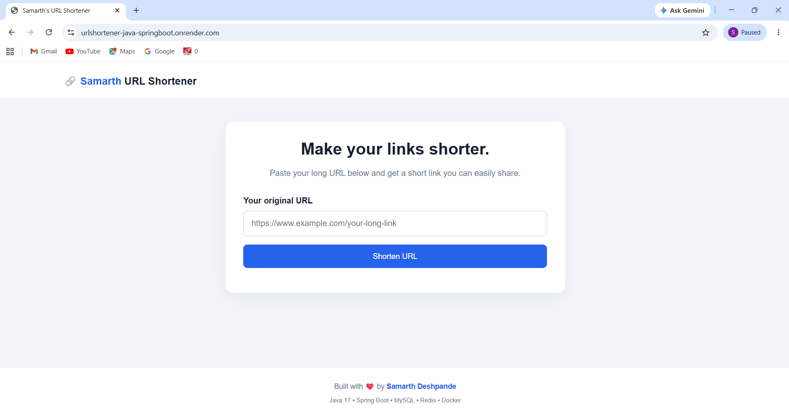
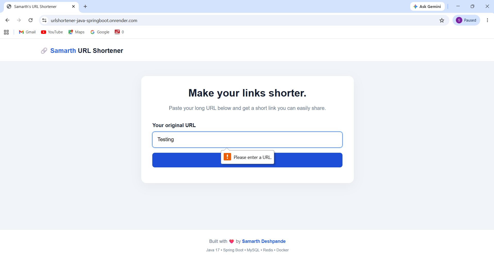

# URL Shortener | Java Spring Boot

A TinyURL-inspired URL Shortener built using Java, Spring Boot, MySQL, Redis-compatible caching, and a simple web frontend. The application converts long URLs into short links and redirects users to the original URLs.

## Features

- **URL Shortening:** Generate unique short codes for long URLs.
- **URL Redirection:** Redirect users to the original URL using the short link.
- **URL Validation:** Validate user input and display errors for invalid URLs.
- **MySQL Database:** Store URL mappings and click counts.
- **Redis Caching:** Cache frequently accessed URL mappings to improve response time.
- **Click Tracking:** Track the number of times a short URL is accessed.
- **REST API:** Expose endpoints for creating and resolving short URLs.
- **Health Monitoring:** Spring Boot Actuator health and metrics endpoints.
- **Responsive Frontend:** Simple web interface for creating short links.
- **Cloud Deployment:** Deployed using Render with a managed MySQL database and Valkey cache.

## Tech Stack

- **Language:** Java 17
- **Framework:** Spring Boot
- **Database:** MySQL
- **Caching:** Redis-compatible Valkey
- **ORM:** Spring Data JPA / Hibernate
- **Build Tool:** Maven
- **Monitoring:** Spring Boot Actuator
- **Frontend:** HTML, CSS, JavaScript
- **Deployment:** Docker, Render
- **Version Control:** Git and GitHub

## Application Screenshots

### Homepage



### Invalid URL Validation

The application validates user input and displays an error when an invalid URL is entered.



## Demo Video

[Watch the 10-second project demo](docs/video/demo.mp4)

## API Endpoints

| Method | Endpoint | Description |
|---|---|---|
| POST | `/api/urls` | Create a short URL |
| GET | `/{shortCode}` | Redirect to the original URL |
| GET | `/actuator/health` | Check application health |
| GET | `/actuator/metrics` | View application metrics |

## Run Locally

### Prerequisites

- Java 17 or later
- MySQL
- Redis-compatible cache (optional if caching is configured to be disabled)
- Git

### 1. Clone the repository

```bash
git clone https://github.com/Samarth-S-Deshpande/urlshortener-java-springboot.git
cd urlshortener-java-springboot
```

### 2. Configure the database

Create a MySQL database named `url_shortener` and configure your database connection in `src/main/resources/application.properties`.

Use environment variables for passwords and other secrets. Do not commit real credentials to GitHub.

### 3. Run the application

On Windows:

```powershell
.\mvnw.cmd spring-boot:run
```

On Linux or macOS:

```bash
./mvnw spring-boot:run
```

The application will typically be available at:

`http://localhost:8080`

## Example Usage

Send a POST request to `/api/urls` with a JSON body:

```json
{
  "url": "https://www.google.com"
}
```

The application returns a short code and a short URL. Use the generated short URL in your browser to redirect to the original destination.

## Deployment

The application is deployed on Render, with MySQL and Valkey hosted separately.

Configure the required database and cache environment variables in the deployment platform. Never expose database passwords, cache passwords, or other secrets in source code.


## Author

**Samarth S. Deshpande**

GitHub: [Samarth-S-Deshpande](https://github.com/Samarth-S-Deshpande)

